# BFBackup

Incremental file backup between Unraid servers, as **plain files**. Made
for Unraid, and works the same on any Linux host with Docker.

**Plain files was the goal.** A backup is just a folder with your files,
exactly as they are on the source: no repository, no archive, no chunk
store, no special format. You can open, copy or restore them with any file
manager, `cp` or a second computer, without BFBackup and without the
database. If BFBackup is gone tomorrow, your backups are still just files.

One **controller** container has the web UI, schedules and database.
**Peers** (other servers) connect to it with a token and send or receive
files. Targets can also be local folders and USB drives.

[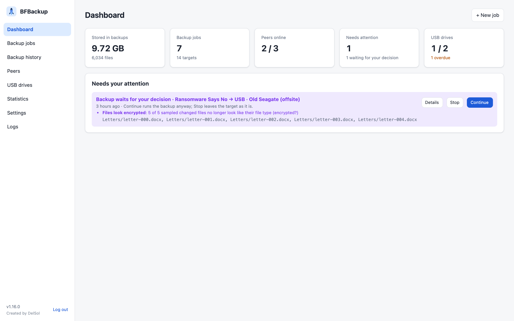](public-release/screenshots/)

```
 Unraid (controller)                      Colo / storage server (peer)
 ┌──────────────────────┐   TCP 7701     ┌──────────────────────┐
 │ web UI :7700         │◀───────────────│ bfbackup peer        │
 │ /mnt/user/Photos ────┼── files ──────▶│ /mnt/user/Backups/…  │
 └──────────────────────┘                └──────────────────────┘
```

## Features

* **Incremental**: only new and changed files move. Per job you choose how a
  change is detected: *size*, *size + mtime* (default) or *checksum*.
* **Fast on LAN**: many files in parallel over one TCP connection, 1 MiB
  chunks, TLS 1.3 by default (optionally unencrypted). Every file is
  SHA-256-checked end to end.
* **Push or pull**: a job's source can be the controller or any peer, and so
  can its targets. A job can have several targets with their own schedules.
  A target can also back up **when its peer comes online** (after more than
  5 minutes offline), for backup servers that are not always running.
* **USB drives for offline backups** (page *USB drives*): plug a drive into
  the controller's server and mount it with Unassigned Devices; BFBackup
  finds it, you set it up once (name, which jobs go on it). From then on it
  is recognized by a marker file, whatever its mount path, and backs up
  when plugged in (optionally with a quick verify). The page shows per drive
  what is on it, size, last backup and verify, whether it is safe to
  unmount, and warns when a drive was not connected for too long. Writes
  never go to the empty folder an unplugged drive leaves behind.
* **One run per peer**: a peer takes part in one run at a time (as source,
  target or restore destination). Other runs that need it wait in a queue
  and start in the order they were started; the dashboard says what each one
  waits for. Runs on other peers or only on the controller go ahead, up to
  the *parallel runs* setting. Runs that are due at the same moment queue in
  job order; a second run of the same kind for the same target is skipped.
* **Files already on the target** (copied there by hand or another tool) are
  taken over on the first backup: with an empty index, the target is scanned
  once, and files that match the source by the job's comparison (size, size +
  time, or checksum) are not copied again. Only what is missing counts for the
  free-space check.
* **Exclusions** per job (type them or click through the source) plus a
  **global list** for junk like `.DS_Store`, `Thumbs.db` and recycle bins
  (Settings; a job can switch it off).
* **Deletes never propagate on their own.** Files deleted on the source stay
  in the backup and show up as *not in source*, until you delete them.
* **Job types**: *copy* (new and changed files; extra files on the target
  stay) or *sync* (files gone from the source are removed from the target).
  Per job: what happens to a changed file that exists on the target (replace,
  replace only if newer, keep, or stop and ask) and whether removed files go
  to the trash (default) or are deleted. Replaced files are overwritten in
  place, so the target does not hold a second copy in the trash.
* **Anomaly checks** (Settings, for all jobs, each can be switched off): far
  more changes or deletions than in the last backups, many files that would be
  removed, files that look encrypted, renames to new extensions, a much smaller
  source, files that became empty, times in the future, and a fixed limit. A
  backup that trips one stops before changing anything and waits for your
  decision on the dashboard and the jobs page (plus a notification).
* **Safety checks**: refuses to run when the source looks empty (unmounted
  disk), checks free space on the target before copying.
* **Browse and restore** single files, folders or search results, to the
  original place or anywhere else. Incremental: identical files are skipped.
  Files that a restore would overwrite go to the trash first.
* **Delete** files/folders from the backup, from all backups, or everywhere
  (source too). Everything goes to `.bfbackup-trash/` first and is purged
  after the retention period, unless you tick **Delete permanently**.
* **Trash overview**: Settings lists the trash of every job folder per node
  (files, size, oldest batch, when it is removed), the job page the trash of
  its own folders. Each run fills one batch, linked to the run; **Empty**
  removes a folder's trash at once.
* **Verify**: *quick* (size and time) or *deep* (re-read and checksum every
  file, finds bit rot). Optional repair re-copies damaged files on the next
  backup. Can run on a schedule.
* **Dry run** shows what a backup would copy.
* **Live progress** with percentage and estimated time left; every run can be
  stopped, or all at once. Completely copied files are kept.
* **Browse** shows folders by size with their share of the current folder
  (sortable by size or name).
* **Pre/post hooks** per job (scripts on the source node).
* **Display**: light, dark or follow the system, and the date format
  (2026-11-07, 07.11.2026, 07/11/2026 or 11/07/2026 with AM/PM), in
  Settings → *Display*.
* **Only what you need**: USB drive backups and hooks can be switched off
  in Settings → *Additional features*; they are then hidden and do nothing.
* **Notifications** by Pushover and/or email (SMTP over TLS/SSL, port 465)
  for failures, approvals, verify problems, peers going offline and targets
  running out of space. The offline alert is set per
  peer (Peers → Edit): after how many hours, or not at all.
* **Statistics**: data per day, space forecast per target. The Peers page
  shows used and free space of every node and the totals.
* **Self-backup**: export/import the configuration; daily database snapshots
  in `/config/db-backups`; download a snapshot in the UI; rebuild a target's
  index from its files if the database is lost.
* **Phone app** (PWA, see [Phone app (Android)](#phone-app-android)): Settings → *App for your phone* installs the web UI
  as an app with its own icon and window; the layout switches to a bottom
  tab bar on narrow screens. Installing needs HTTPS, for example through a
  reverse proxy (Nginx Proxy Manager, SWAG, Caddy) in front of port 7700;
  over plain `http://` a phone can only add a bookmark. The proxy should send
  `X-Forwarded-Proto: https`, then the session cookie is marked `Secure`.
* **Audit log** of all deletes, restores and setting changes.
* **Activity log** (sidebar → Logs) with the events and errors of runs, peers
  and the system. Each run's page ends with its **file log**: one line per
  file it handled or had a problem with, and where (source or which peer).
  Levels (4 = also every unchanged file and each decision): 1 errors only, 2 also events and file
  issues such as unknown files on a target or files gone from the source
  (default), 3 also every file that went fine. Filter and sort by level, kind,
  peer, job, run, time and text. Set the level and retention in Settings;
  stored in `/config/logs.db`.
* **Unknown files on target** (verify): files in the target folder that are
  not in the index, so BFBackup did not copy them, e.g. `.DS_Store` written by
  Finder on the target or files put there by hand. They are left alone and
  listed on the run page and in its file log.
* **Remove excluded files from the targets** (per job): files on a target that
  match the exclusions go to the target's trash. Backups remove files that
  were backed up before a pattern excluded them; verifies remove junk that
  appeared on the target. Nothing is removed when more files match than the
  job's mass-change limit.

## Screenshots

| | |
|---|---|
| [](public-release/screenshots/dashboard.png) | [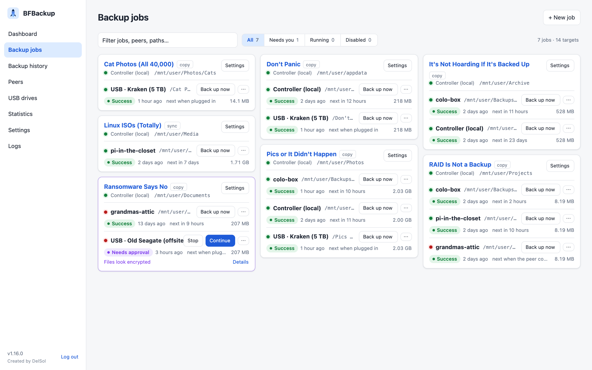](public-release/screenshots/jobs.png) |
| Dashboard | Backup jobs with their targets |
| [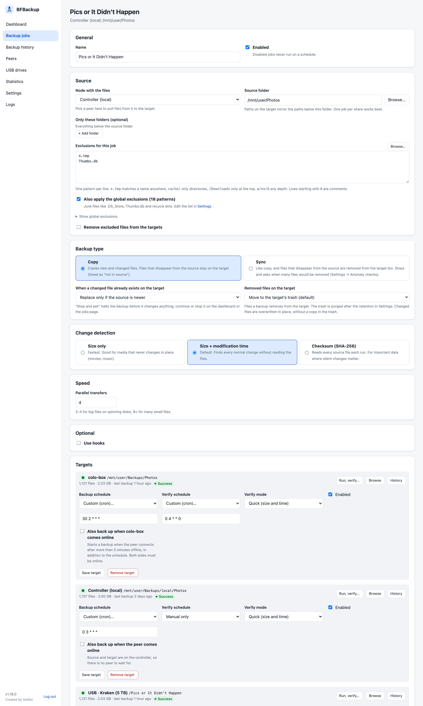](public-release/screenshots/job-edit.png) | [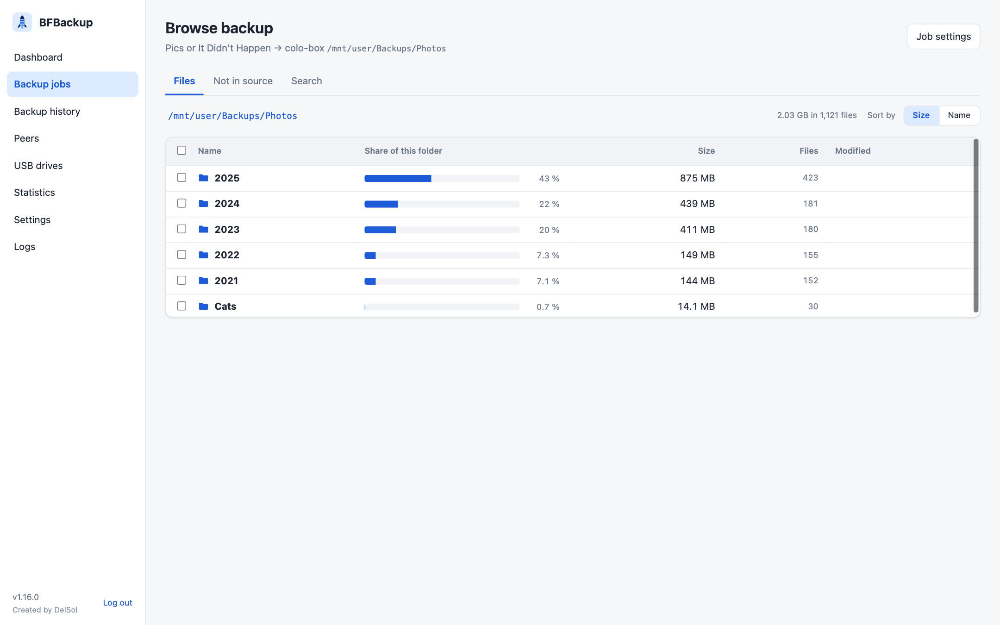](public-release/screenshots/browse.png) |
| Editing a job | Browse and restore |
| [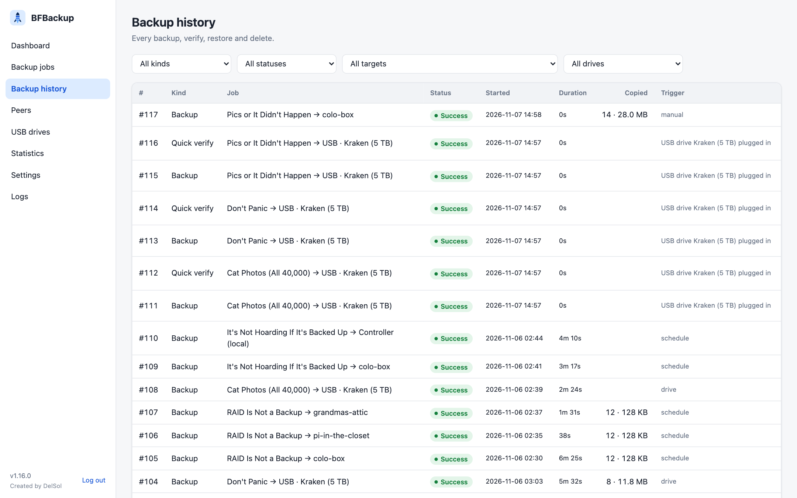](public-release/screenshots/runs.png) | [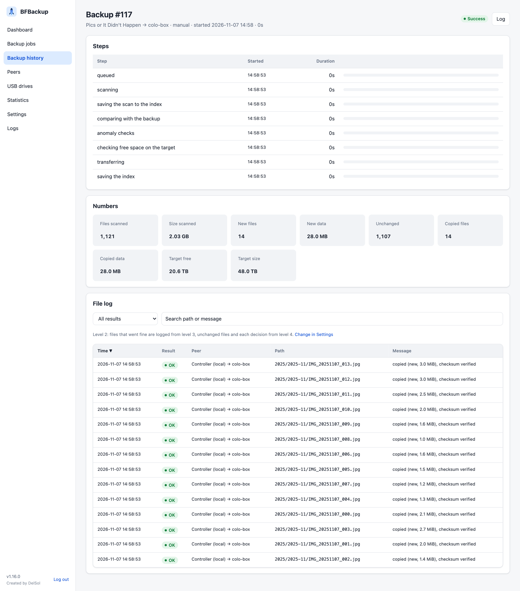](public-release/screenshots/run.png) |
| Run history | One run with its file log |
| [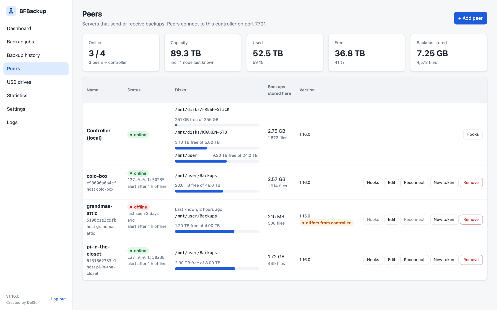](public-release/screenshots/peers.png) | [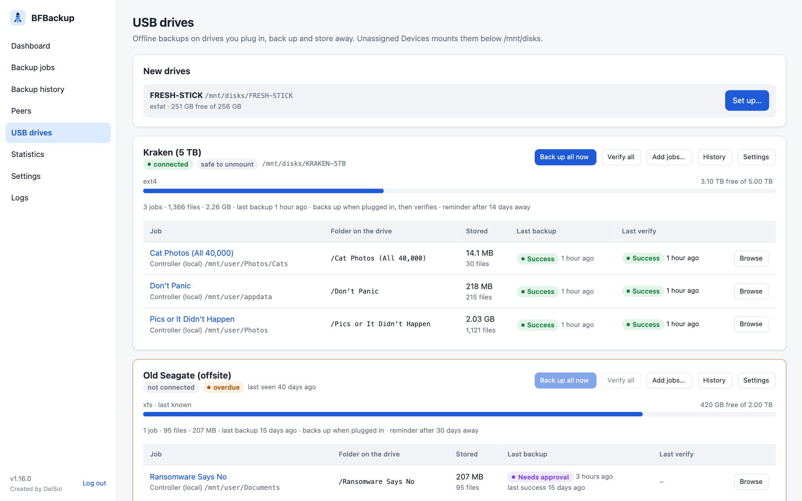](public-release/screenshots/drives.png) |
| Peers and their disks | USB drives |
| [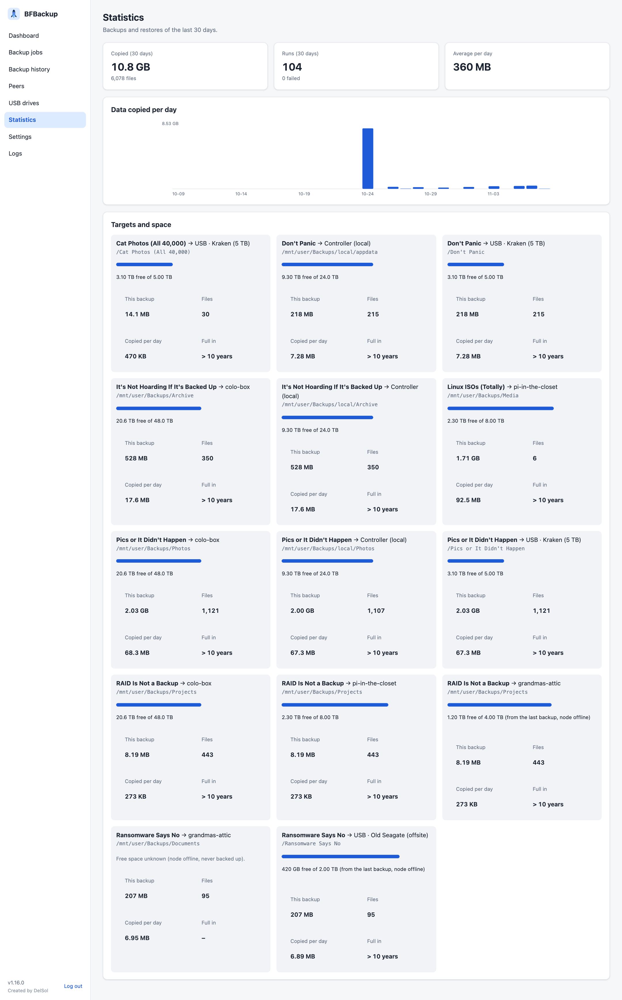](public-release/screenshots/stats.png) | [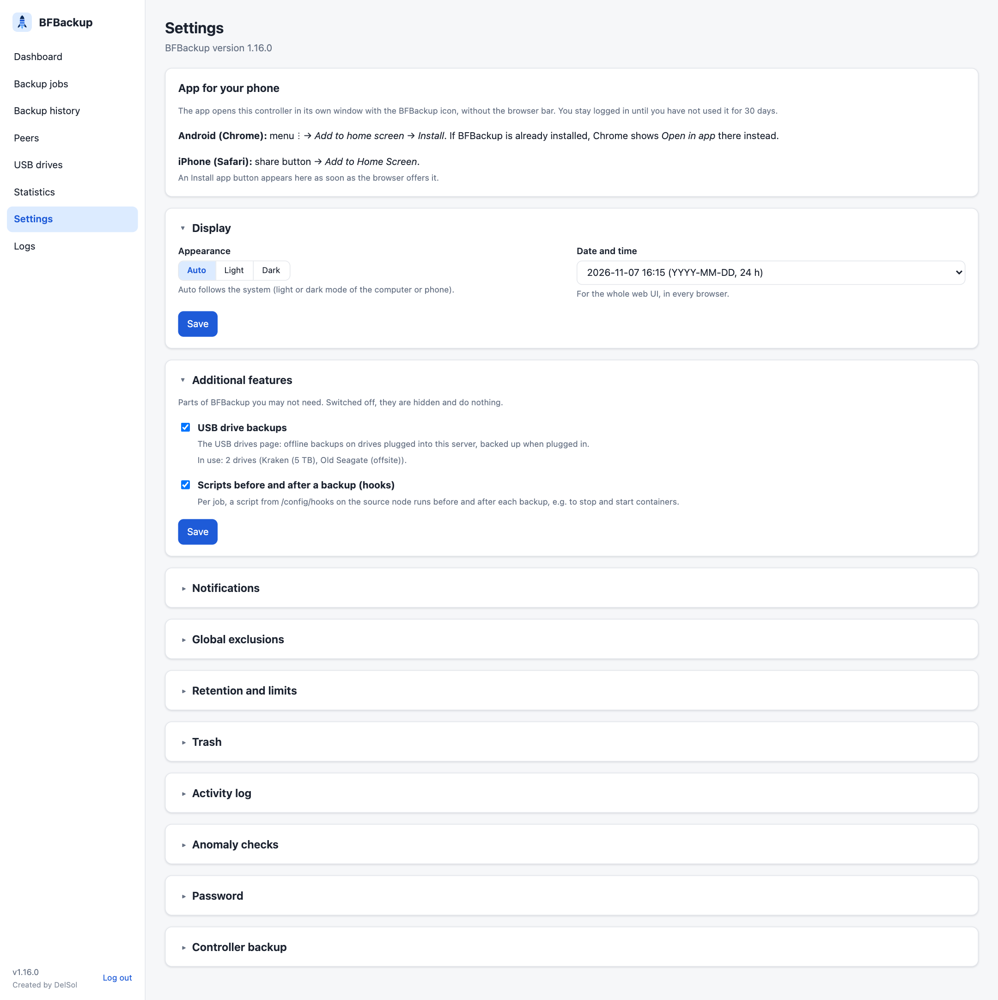](public-release/screenshots/settings.png) |
| Statistics | Settings |

All screenshots: [public-release/screenshots](public-release/screenshots/).

## Phone app (Android)

The web UI installs as an app on Android (a PWA): its own icon on the home
screen, its own window without the browser bar, and a layout with a bottom
tab bar for the phone. Approve a waiting backup, start a run or check your
USB drives from the couch. No app store and no extra container: it is the
controller's web UI.

[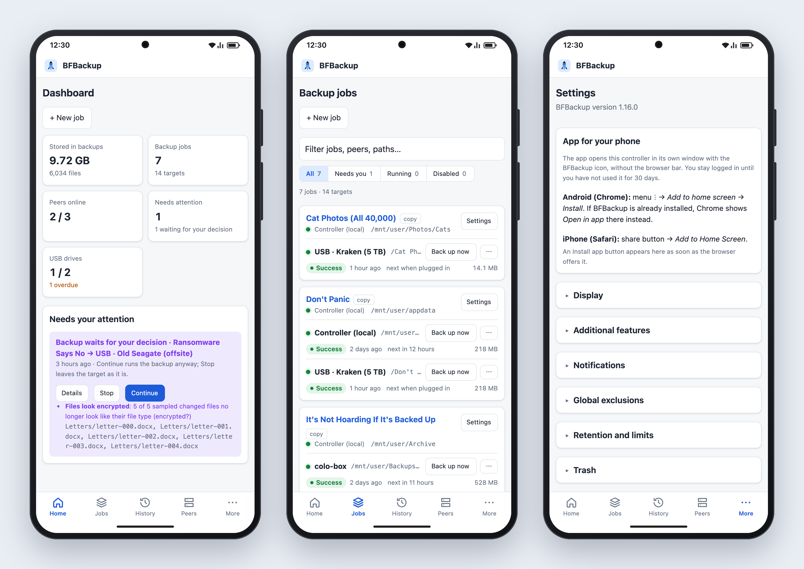](public-release/screenshots/android.png)

**Install**: open the web UI in Chrome on the phone, then menu ⋮ →
*Add to home screen* → *Install* (Settings → *App for your phone* explains
it, too). Installing needs **HTTPS**, for example through a reverse proxy
(Nginx Proxy Manager, SWAG, Caddy) or Tailscale in front of port 7700; over
plain `http://` Chrome only adds a bookmark. On an iPhone it works the same
way with Safari → share → *Add to Home Screen*.

## Install on Unraid

From **Apps** (Community Applications): search for **BFBackup**.

1. Install **bfbackup-controller** on one server.
2. Install **bfbackup-peer** on every other server that sends or keeps
   backups. A single server with only local disks or USB drives needs no
   peer.

Without the App Store, see
[public-release/unraid](public-release/unraid/README.md) for the templates.

1. **Controller**: start it, open `http://<server>:7700`, choose the admin
   password.
2. **Peers** page → *Add peer* → copy the token.
3. On the other server: install the peer template, set *Controller address*
   (e.g. `192.168.1.10`) and *Token*. The peer shows up as online.
4. **Backup jobs** → *New job*: pick the source folder (one job per share
   works best), the target node and folder, and a schedule.

A peer needs no open ports; it connects to the controller's port 7701.

**Trash on full disks.** A file in a user share sits on one disk, and moving
it into `.bfbackup-trash/` through `/mnt/user` keeps it there. When that disk
is full (or below the share's minimum free space), Unraid refuses the move
although the share has room, and BFBackup has to copy the file to another
disk instead. The templates therefore map all of `/mnt` (path *Storage*,
`/mnt` → `/mnt`, read/write slave), so BFBackup sees the single disks and
moves the file on its own disk, without copying. The single disks are never
shown (folder picker, disk statistics); only `/mnt/user` and `/mnt/disks`
are. Containers set up with the older templates (*User shares* `/mnt/user`
and *Unassigned disks* `/mnt/disks`): Docker → Edit, remove those two paths,
add one path with container and host path `/mnt` and access mode
*Read/Write – Slave*. Job paths stay the same.

**A peer does not connect?** Look at `connection.log` in the peer's appdata
folder (`/mnt/user/appdata/bfbackup-peer/connection.log`, inside the
container `/config/connection.log`). It lists every attempt: name lookup,
TCP connection, authentication, disconnects with their duration, and
configuration errors that stop the peer. Each failure comes with a hint, for
example "nothing listens on that port" or "the controller does not know this
peer". Identical failures in a row are written in full three times, then every
tenth time. The token secret is never written. The file is capped at 5 MB;
the previous one is kept as `connection.log.1`.

## Install on other Linux hosts

Any Linux machine with Docker works: a NAS, a Raspberry Pi,
a VPS or a desktop. Compose files:

* [controller.compose.yml](public-release/docker/controller.compose.yml)
* [peer.compose.yml](public-release/docker/peer.compose.yml)
* [try-it.compose.yml](public-release/docker/try-it.compose.yml): controller
  and peer on one machine, to try it out
* [unraid.compose.yml](public-release/docker/unraid.compose.yml): for the
  Unraid Compose Manager plugin

Map whole host folders at the same path inside the container (`/srv:/srv`),
like the Unraid templates do with `/mnt`, so paths in the UI match the host.
Every file system mounted *below* an allowed root shows up as a possible
drive on the *USB drives* page, so map a few large folders rather than many
small ones. Unraid-only features (moving to the trash on the same array
disk) are simply not used elsewhere.

Image: [`delsolger/bfbackup`](https://hub.docker.com/r/delsolger/bfbackup),
tags `latest`, `1`, `1.16`, `1.16.0`, for `linux/amd64`, `linux/arm64` and
`linux/arm/v7`.

## Configuration (environment)

Everything else is set in the web UI.

| Variable | Role | Default | Meaning |
|---|---|---|---|
| `BFB_ROLE` | both | – | `controller` or `peer` (or pass it as the command) |
| `BFB_ROOTS` | both | `/mnt` | Comma-separated folders BFBackup may access. Nothing outside is reachable, symlinks included. |
| `BFB_DATA` | both | `/config` | Database, `hooks/`, `db-backups/` |
| `BFB_UID`, `BFB_GID` | both | unset | Owner for files/folders BFBackup creates (Unraid: 99/100) |
| `BFB_LOG_LEVEL` | both | `info` | `debug`, `info`, `warn`, `error` |
| `BFB_HTTP_ADDR` | controller | `:7700` | Web UI |
| `BFB_PEER_ADDR` | controller | `:7701` | Peer connections |
| `BFB_ADMIN_PASSWORD` | controller | – | Sets the password on first start (otherwise set in the browser) |
| `BFB_CONTROLLER` | peer | – | `host` or `host:port` of the controller |
| `BFB_TOKEN` | peer | – | Token from the controller's Peers page |
| `BFB_TRANSPORT` | peer | `tls` | `tls` (encrypted) or `plain` (unencrypted, for slow CPUs on fast links) |
| `BFB_TRANSPORT` | controller | `auto` | `auto` accepts encrypted and unencrypted peers, `tls` refuses unencrypted ones |

## How it works

* The controller keeps an **index** per target (SQLite): path, size, mtime,
  SHA-256 and when the file was last seen on the source. Backups compare the
  source with the index directory by directory, so target disks don't have to
  spin up for planning and memory stays flat with millions of files.
* Files are written to a temp file next to the target, checked, then renamed
  into place. An interrupted run never leaves half files under the real name.
* Ownership is not copied (set `BFB_UID`/`BFB_GID` instead). Permission bits
  and mtimes are. Symlinks are copied as symlinks. Devices, sockets and FIFOs
  are skipped. Empty directories are not copied.
* Exclusions use gitignore-like patterns: `*.tmp`, `cache/` (directories),
  `/Downloads` (top level only), `photos/**/*.raw`.

### Hooks

Put executable scripts into `/config/hooks/` **on the source node** and enter
their file name in the job. The controller can only pick a script by name,
never send commands. Environment: `BFB_PHASE` (`pre`/`post`), `BFB_JOB`,
`BFB_JOB_ID`, `BFB_RUN_ID`, `BFB_SOURCE_PATH`, `BFB_TARGET_NODE`,
`BFB_TARGET_PATH`, and for post-hooks `BFB_RUN_STATUS`. A failing pre-hook
skips the backup; the post-hook runs after every backup that got past the
pre-hook. Timeout: 1 hour.

## Security

* **Peers**: token = node ID + 256-bit secret. The secret never crosses the
  network; both sides prove they know it with HMAC challenge-response, and
  the **peer checks the controller first**, so a fake controller cannot read
  a peer's files. *Peers → New token* revokes a token immediately.
* **Transport**: TLS 1.3 by default. There are no certificates to manage: the
  handshake is bound to the TLS session (channel binding), so a man in the
  middle fails the token check even though nobody verifies a certificate.
  Peers need nothing but their token. The Peers page marks peers that connect
  unencrypted (older versions or `BFB_TRANSPORT=plain`); once all are
  updated, set `BFB_TRANSPORT=tls` on the controller to refuse unencrypted
  connections. Unencrypted connections can be read *and altered* by anyone
  on the network path.
* Encryption costs CPU on one core per direction: irrelevant on 1 GbE with
  any CPU that has AES-NI, possibly limiting on 10 GbE with a weak CPU.
  Update the controller first: a new peer cannot reach an old controller
  (its connection log says so); old peers keep working with a new one.
* **Web UI**: one admin user, bcrypt, `HttpOnly` + `SameSite=Strict` session
  cookie, CSRF header on every change, login rate limit, strict CSP. A
  session lasts until it has not been used for 30 days (each use renews it),
  until you log out, or until the password changes. Meant for LAN (or VPN)
  only; don't expose port 7700 to the internet, also not through the proxy.
* The configuration export contains the peer tokens. Keep it safe.
* **File access**: BFBackup only touches the folders in `BFB_ROOTS`
  (symlinks included). The Unraid templates map all of `/mnt` read/write,
  because moving removed files into the trash on their own disk needs the
  single disks. On peers, narrow `BFB_ROOTS` to the backup folder (e.g.
  `/mnt/user/Backups`), so the controller cannot see anything else there.
* **Root inside the container**: BFBackup runs as root in the container, so
  it can read every file it backs up and give the files it writes the owner
  you set (`BFB_UID`/`BFB_GID`). The container is not privileged and needs
  no extra capabilities.
* **No encryption at rest**, on purpose: backups are plain files. Protect
  the target disks like the originals (disk encryption, physical access),
  especially USB drives you take off-site.
* **Reporting security problems**: privately, see
  the [security policy](https://github.com/delsol-ger/bfbackup/security/policy),
  not as a public issue.

## Development

```bash
make test      # all tests (uses Docker if Go is not installed)
make race      # tests with the race detector
make docker    # build the image
make dev-up    # controller on http://localhost:7700 with ./testdata
```

Build from source: `docker build -t bfbackup:latest .` (multi-arch with
`docker buildx build --platform linux/amd64,linux/arm64,linux/arm/v7 .`).

Code map: [docs/DESIGN.md](docs/DESIGN.md). Logo and icons: `CI/icon/` (copied into `internal/web/static/`).
Unraid templates, compose files and screenshots:
[public-release/](public-release/).

## Roadmap and feature requests

Not (yet) included: versioning of old file versions, catch-up of missed
schedules, 2FA / several users. Encryption at rest is left out on purpose.

Current feature requests and what is planned: [ROADMAP.md](ROADMAP.md).
New ideas: open a
[feature request](https://github.com/delsol-ger/bfbackup/issues/new?template=feature_request.yml).

## License

[GPL-3.0](LICENSE). You may use, change and share BFBackup; changed
versions you distribute must stay open source under the same license.
