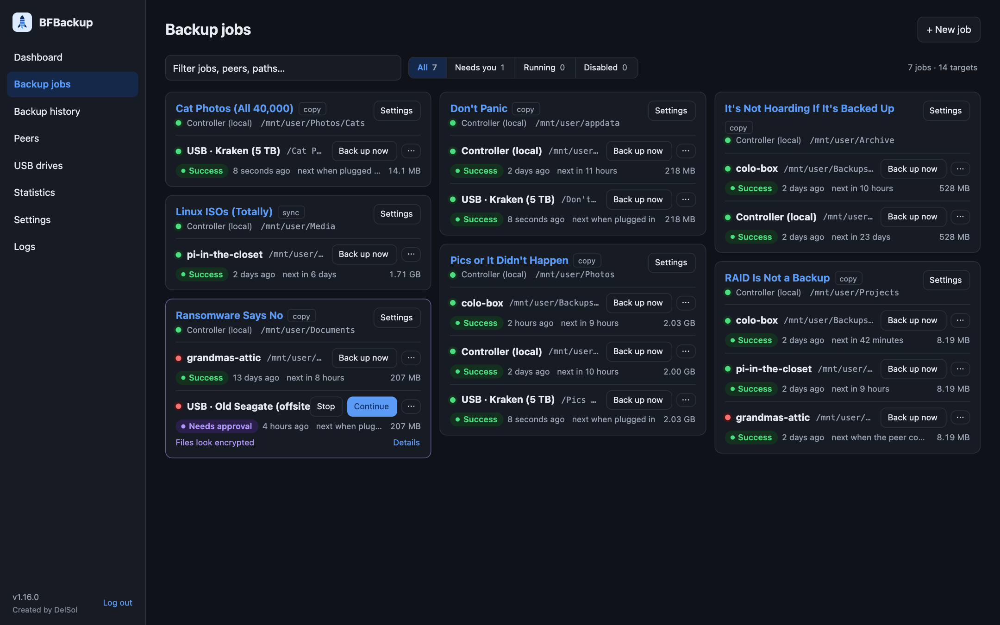

# BFBackup

[](public-release/screenshots/)

Incremental backup between Unraid servers (or any Linux host with Docker),
stored as **plain files**: no repository, no archive, no special format. If
BFBackup is gone tomorrow, your backups are still just folders you can open
and copy.

One **controller** container has the web UI, schedules and database.
**Peers** on other servers connect to it with a token and send or receive
files. Targets can also be local folders and USB drives.

## Features

* **Incremental**: only new and changed files move, SHA-256-checked end to end
* **Fast and encrypted**: parallel transfers over one connection, TLS 1.3
* **Push or pull**: any node can be source or target; several targets per job
* **USB drives** for offline backups, backed up automatically when plugged in
* **Deletes never propagate on their own**: removed files go to a trash first
* **Anomaly checks** (mass changes, files that look encrypted, …) pause a
  backup until you approve it
* **Browse and restore** single files, folders or search results
* **Verify** quick or deep (finds bit rot), on a schedule if you like
* **Notifications** by Pushover or email
* **Statistics**, activity log, audit log, light and dark theme
* **Phone app** (PWA) for Android and iPhone

More screenshots: [public-release/screenshots](public-release/screenshots/).

## Install on Unraid

1. **Apps** (Community Applications) → search **BFBackup**.
2. Install **bfbackup-controller** on one server, open `http://<server>:7700`
   and choose the admin password.
3. **Peers** → *Add peer* → copy the token.
4. Install **bfbackup-peer** on every other server, set *Controller address*
   and *Token*. Peers need no open ports (they connect to port 7701).
5. **Backup jobs** → *New job*: pick source, target and schedule.

A single server with only local disks or USB drives needs no peer.
Templates without the App Store: [public-release/unraid](public-release/unraid/README.md).

## Install with Docker (any Linux host)

Image: [`delsolger/bfbackup`](https://hub.docker.com/r/delsolger/bfbackup)
(`amd64`, `arm64`, `arm/v7`). Compose files:

* [controller.compose.yml](public-release/docker/controller.compose.yml)
* [peer.compose.yml](public-release/docker/peer.compose.yml)
* [try-it.compose.yml](public-release/docker/try-it.compose.yml): controller
  and peer on one machine, to try it out
* [unraid.compose.yml](public-release/docker/unraid.compose.yml): for the
  Unraid Compose Manager plugin

Map host folders at the same path inside the container (`/srv:/srv`).

## Configuration

Everything is set in the web UI, except:

| Variable | Role | Default | Meaning |
|---|---|---|---|
| `BFB_ROLE` | both | – | `controller` or `peer` |
| `BFB_ROOTS` | both | `/mnt` | Folders BFBackup may access |
| `BFB_DATA` | both | `/config` | Database and settings |
| `BFB_UID`, `BFB_GID` | both | unset | Owner of written files (Unraid: 99/100) |
| `BFB_HTTP_ADDR` | controller | `:7700` | Web UI |
| `BFB_PEER_ADDR` | controller | `:7701` | Peer connections |
| `BFB_CONTROLLER` | peer | – | `host` or `host:port` of the controller |
| `BFB_TOKEN` | peer | – | Token from the Peers page |

## Good to know

* Meant for LAN or VPN: don't expose port 7700 to the internet.
* Installing the phone app needs HTTPS (e.g. a reverse proxy in front of 7700).
* Peer doesn't connect? See `/config/connection.log` on the peer.
* Security problems: report privately via the
  [security policy](https://github.com/delsol-ger/bfbackup/security/policy).
* Planned features: [ROADMAP.md](ROADMAP.md) ·
  [feature request](https://github.com/delsol-ger/bfbackup/issues/new?template=feature_request.yml)

## Development

```bash
make test      # all tests (uses Docker if Go is not installed)
make dev-up    # controller on http://localhost:7700 with ./testdata
```

Code map: [docs/DESIGN.md](docs/DESIGN.md).

## License

[GPL-3.0](LICENSE)
